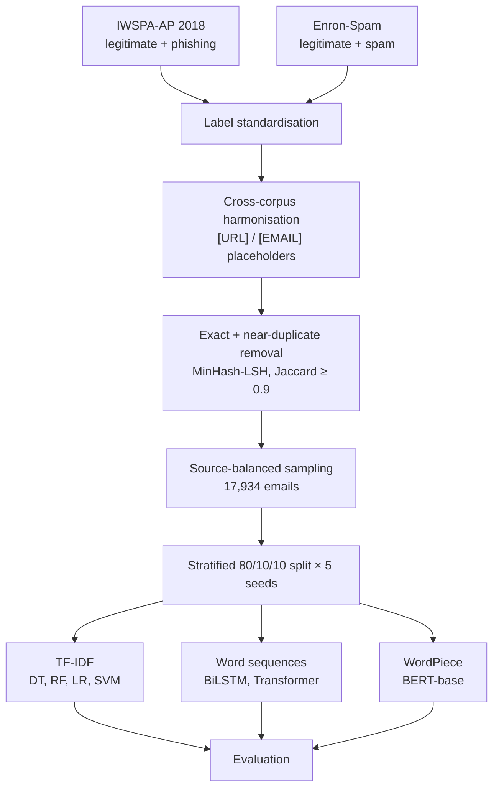

# From Decision Trees to BERT: Phishing and Spam Email Detection

Code for the paper

> S. Mondal, R. C. Ghosh, A. M. Avi, and J. Tasnim, "From Decision Trees to BERT: A Comparative Evaluation of ML and DL Models for Phishing and Spam Email Detection," *29th International Conference on Computer and Information Technology (ICCIT)*, Cox's Bazar, Bangladesh, 2026.

We compare seven models (Decision Tree, Random Forest, Logistic Regression, linear SVM, BiLSTM, Transformer and BERT) for classifying emails as **legitimate** or **malicious** (phishing or spam). The two public corpora are merged in a way that avoids the usual shortcuts: duplicates are removed before splitting, and both corpora contribute both classes, so the source of an email does not reveal its label.

## Pipeline



## Main results

In-domain test results, mean ± std over five seeds (80/10/10 splits). FPR is the share of legitimate emails flagged as malicious.

| Model | Accuracy | F1 | Phishing recall | Spam recall | FPR | CPU latency (ms/email) |
|---|---|---|---|---|---|---|
| Decision Tree | 0.925 ± 0.007 | 0.924 ± 0.007 | 0.866 | 0.924 | 6.8% | 1.1 |
| Random Forest | 0.968 ± 0.003 | 0.968 ± 0.003 | 0.928 | 0.987 | 4.5% | 43.5 |
| Logistic Regression | 0.981 ± 0.003 | 0.982 ± 0.003 | 0.959 | 0.993 | 2.6% | 1.1 |
| Linear SVM | 0.983 ± 0.004 | 0.983 ± 0.004 | 0.957 | 0.993 | 2.3% | 1.1 |
| BiLSTM | 0.967 ± 0.008 | 0.968 ± 0.008 | 0.951 | 0.984 | 4.6% | 22.0 |
| Transformer | 0.965 ± 0.007 | 0.965 ± 0.007 | 0.938 | 0.977 | 4.3% | 4.2 |
| **BERT** | **0.986 ± 0.003** | **0.986 ± 0.003** | **0.973** | 0.988 | **1.4%** | 97.0 |

When a model is trained on one corpus and tested on the other, F1 drops to 0.79 (Enron → IWSPA) and 0.59 (IWSPA → Enron) for BERT, and lower for the other models. See the paper for the full analysis.

## Repository layout

```
├── prepare_data.py          step 1: build the dataset
├── run_experiments.py       step 2: train and evaluate (E1-E4, diagnostic)
├── make_report.py           step 3: tables, significance tests, figures
├── run_eda.py               sentiment and LSA topics per email type
├── email_detection/
│   ├── config.py            every setting used in the paper
│   ├── text.py              harmonisation and cleaning
│   ├── data.py              loading, de-duplication, sampling, splits
│   ├── classical.py         TF-IDF + DT / RF / LR / SVM
│   ├── neural.py            BiLSTM and Transformer
│   ├── bert.py              BERT fine-tuning
│   ├── experiments.py       E1-E4 and the diagnostic
│   ├── evaluation.py        metrics and result storage
│   ├── report.py            summary tables and statistical tests
│   └── figures.py           paper figures
├── data/                    put the two CSV files here (see data/README.md)
└── docs/workflow.mmd        Mermaid source of the pipeline figure
```

## Setup

Python 3.10 or newer. A CUDA GPU is strongly recommended for BERT.

```bash
conda create -n email-detection python=3.11 -y
conda activate email-detection

# PyTorch with CUDA (pick the command for your system at https://pytorch.org)
pip install torch --index-url https://download.pytorch.org/whl/cu121

pip install -r requirements.txt
```

Use an environment without TensorFlow, or keep it: `email_detection/bert.py` tells `transformers` not to import it.

## Data

The datasets are not included in this repository. Download them and place them in `data/` as described in [`data/README.md`](data/README.md):

```
data/IWSPA-AP-Parsed.csv
data/enron_spam_dataset.csv
```

## Reproducing the paper

```bash
python prepare_data.py       # about 3 minutes; prints Table I
python run_experiments.py    # about 2-3 hours on an RTX 4060 (BERT takes most of it)
python make_report.py        # tables and figures in results/
python run_eda.py            # sentiment and LSA topics (Section III-E)
```

Useful options:

```bash
python run_experiments.py --experiments E1                 # in-domain only
python run_experiments.py --models LR SVM --experiments E1 E2
python run_experiments.py --fast-bert                      # DistilBERT, 128 tokens, about 3x faster
```

Runs are saved one by one in `results/preds/`. If the script stops, run it again and it continues where it left off.

### What each experiment does

| ID | Experiment | Output |
|---|---|---|
| E1 | In-domain: 7 models × 5 seeds, 80/10/10 splits | `tables/in_domain.csv`, confusion matrices, learning curves |
| E2 | Cross-source: train on one corpus, test on the other | `tables/cross_source.csv` |
| E3 | Ablation: legacy vs new cleaning, 1k vs 50k TF-IDF terms | `tables/ablation.csv` |
| E4 | Single-email latency on CPU/GPU and model size | `tables/cost.csv` |
| D  | Diagnostic: what a model trained on a label-confounded merge learns | `tables/diagnostics.csv` |

### Main settings

| | |
|---|---|
| Splits | stratified by source × type, 80/10/10, seeds 0-4 |
| TF-IDF | unigrams + bigrams, 50,000 terms, min_df = 2, max_df = 0.95, sublinear TF |
| LR / SVM | C ∈ {0.1, 1, 10}, chosen per seed by validation F1 |
| Random Forest | 300 trees |
| BiLSTM / Transformer | 60,000-word vocabulary, 250 words, Adam 1e-3, batch 64, early stopping on validation loss |
| BERT | `bert-base-uncased`, 256 tokens, AdamW 2e-5, batch 16, 10% warm-up, early stopping on validation F1 |

All values live in `email_detection/config.py`.

Our runs used an NVIDIA RTX 4060 (8 GB), 16 GB RAM, CUDA 11.8, PyTorch 2.5.1 and Python 3.12.7; the exact package versions are listed in `requirements-lock.txt`.

### Reproducibility notes

- **Dataset.** `prepare_data.py` rebuilds the exact 17,934 emails of the paper from `data/paper_dataset_ids.csv`, which holds only row numbers of the original CSV files (no email text). This is needed because MinHash-LSH can find slightly different near-duplicate groups with other `datasketch`/`scipy` versions, which would change the random sample. Use `--resample` to build a fresh sample instead.
- **Classical models.** With other scikit-learn versions, terms tied in frequency at the 50,000-term cutoff can be kept differently. In our tests this changed 1 of 1,794 test predictions for LR and SVM and slightly more for the tree models. With the versions in `requirements-lock.txt` the results are identical.
- **Neural models.** GPU training is not bit-for-bit deterministic, so BiLSTM, Transformer and BERT results can differ in the third decimal.
